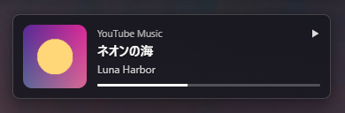

# NowPlaying

## 概要

再生中の音楽等をオーバーレイ表示します。  
Discord の RPC への表示も可能です。

## 使い方

### ダウンロード

1. [WebNowPlaying](https://chromewebstore.google.com/detail/webnowplaying/jfakgfcdgpghbbefmdfjkbdlibjgnbli?hl=ja)をブラウザに追加します。

2. [NowPlaying.exe](https://github.com/Alice-river/NowPlaying/releases/latest/download/NowPlaying.exe) をダウンロードします。

### 設定

**[必須]WebNowPlaying 側の設定**

1. ブラウザ上のWebNowPlaying のアイコンをクリックします。
2. Add custom adapterを押し、ポートに `37250` を指定します。

画面の右上にオーバーレイが出れば、つながっています。

**[任意]NowPlaying 側の設定**

タスクトレイのアイコンをダブルクリックすると、設定画面が開きます。

| 項目 | 内容 |
| --- | --- |
| 透過率 | オーバーレイの背景の濃さ |
| 後ろをぼかす | 背景をすりガラスにします。切ると、後ろの画面がそのまま透けます |
| Discord | Discord への表示の切り替えと、Application ID の入力 |
| Windows の起動時に自動で起動する | オンにすると、サインインのたびに自動で起動します |

オーバーレイは、ドラッグで好きな位置に動かせます。一時停止から10秒たつと、自動で隠れます。トレイを右クリックすると、一時的に隠す、クリックを通す、位置を右上に戻す、の操作ができます。

### [任意]Spotify(デスクトップアプリ)

Spotify のデスクトップアプリで曲を再生すると、WebNowPlaying を使わずに、再生中の曲を表示できます。Windows の SMTC(メディア転送コントロール)から読み取ります。

- Spotify が起動していて曲の情報があるあいだは、ブラウザの再生より **Spotify を優先** します。Spotify を終了すると、ブラウザの再生に戻ります。
- Spotify の設定で「メディアキーを使用するときにデスクトップのオーバーレイを表示する」をオンにしてください。オフだと、Spotify が情報を出しません。
- 設定画面の「Spotify」で、優先表示をオフにできます。

### [任意]Discord連携

Discord への表示には、ApplicationIDが必要です。

1. [Discord Developer Portal](https://discord.com/developers/applications) を開いて、「New Application」を押す
2. 名前を付けて作成する。
3. 「General Information」にある **Application ID** をコピーする。
4. NowPlaying の設定画面を開いて、「Discord」の欄の Application ID に貼り付ける。

欄の下の「状態」が「接続中」になれば完了です。プロフィールに「（曲名）を再生中」と、アーティスト、カバー、進行バーが出ます。

入力するのは Application ID だけです。トークンやシークレットは必要ありません。入力しないでください。

Discord のデスクトップアプリが起動している必要があります（ブラウザ版では使えません）。NowPlaying を先に起動していても、Discord が起動すれば自動でつながります。
